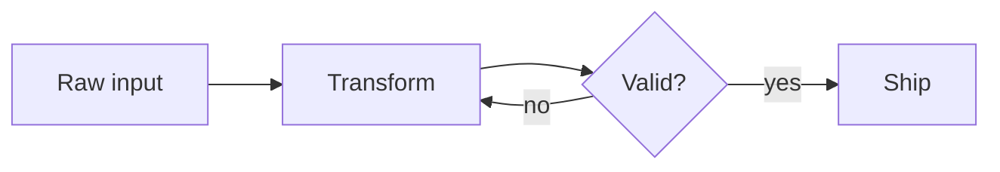
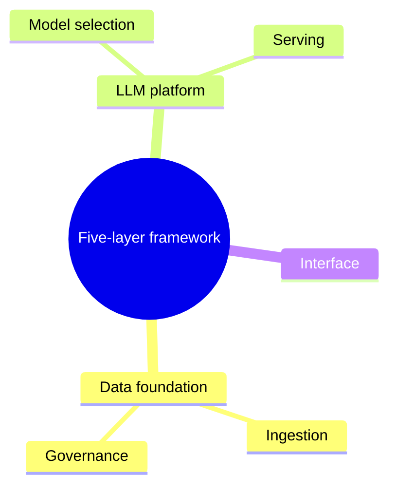

# Mermaid diagrams: flowcharts and mind maps

Status: shipped. Generation rules live in `backend/src/generate/prompt_builder.py`
(`_DIAGRAM_TYPE_SELECTION`, `_DIAGRAM_REGISTERS`, and the flowchart colour-coding
block). In-app help: topics `diagram-flowchart` and `diagram-mindmap`
(`mobile/src/help-content/topics.ts`, feature keys `diagram-flowchart` and
`diagram-mindmap` in `features.ts`).

## What the author gets

Diagrams in a generated lesson are Mermaid text, rendered on the page. The
model picks the diagram type from the content, not by default:

| The content is… | Diagram | Why |
|---|---|---|
| Steps, a decision that branches, data through stages | `flowchart` | The order matters. |
| One central idea with parts around it, layers, a hub with partners | `mindmap` | The structure is a tree, not a sequence. |
| Named relationships with no order and no centre | `flowchart` with labelled edges, grouped in `subgraph`s | Relationships, not steps. |
| Two axes comparing items | `quadrantChart` | Where the register allows it. |
| Interactions over time | `sequenceDiagram` | Messages between parties. |
| A lifecycle | `stateDiagram-v2` | States and transitions. |
| A plain list of facts | No diagram | Prose or a table is clearer. |

A layered architecture is a mind map, not a flowchart. A hub with three or more
spokes is never drawn as arrows out of a box.

## Flowcharts

Use for processes, pipelines and decision logic.

Rules the model follows:

- Each node carries exactly one role tag: `concept`, `process`, `decision`,
  `success` or `warn`. Colours are applied on render. The model must not write
  its own `classDef` lines or hex colours.
- Keep to about 4 to 9 nodes so the diagram stays legible at page width.
- Write every statement and edge on its own line.
- Edge labels are allowed (`A -- informs --> B`) when the relationship is named.

## Mind maps

Use for one central idea with branches.

Rules the model follows:

- Exactly one `root((…))` line is the centre. Each branch is indented under it,
  and details are indented under their branch.
- Mind maps take no role tags; they are themed on render.
- A flowchart with labelled arrows that fans out from one hub is converted to a
  mind map (commit `94a7ae3d`). Decision diamonds are never converted.

## Other register-specific shapes

- **Radial / hub-and-spoke:** a `flowchart` where each node points at one hub.
  The conceptual register uses this for several contributors around one centre.
- **Funnel / stage flow:** a short `flowchart TB` of three or four stages.
- **Quadrant:** a `quadrantChart` with labelled axes and four cells.

The register (conceptual, balanced, technical) limits which of these appear.

## Editing a diagram

In a validated draft, open the topic, tap **Edit diagram**, change the Mermaid
text, tap **Preview**, then **Save diagram**. Saving creates a new version. If
the old version was approved, the new one needs re-approval. See the
`edit-a-diagram` help topic.

## Troubleshooting

- **Preview shows an error:** check that labels with special characters sit in
  double quotes and that each node or branch is on its own line.
- **Mind map branches attach to the wrong parent:** check the indentation. A
  line with the wrong number of spaces moves to a different branch.
- **Diagram is a flowchart when you expected a mind map:** regenerate the topic.
  Regeneration uses the current type-selection rules.

## Tests

Prompt rules are covered by the existing prompt-builder tests
(`backend/tests/test_diagram_register.py`, `backend/tests/test_diagram_type_selection.py`).
The help topics are covered by the help coverage gate
(`mobile/__tests__/help/coverage.test.ts`).
